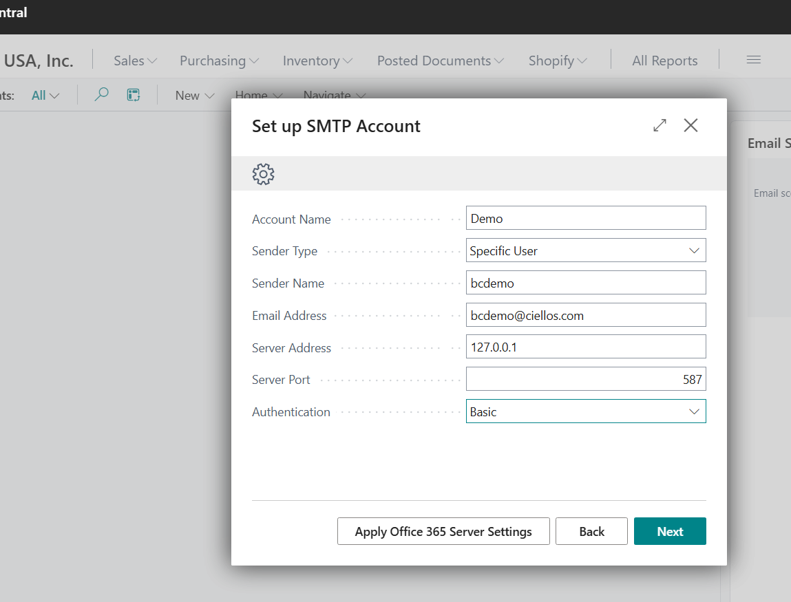
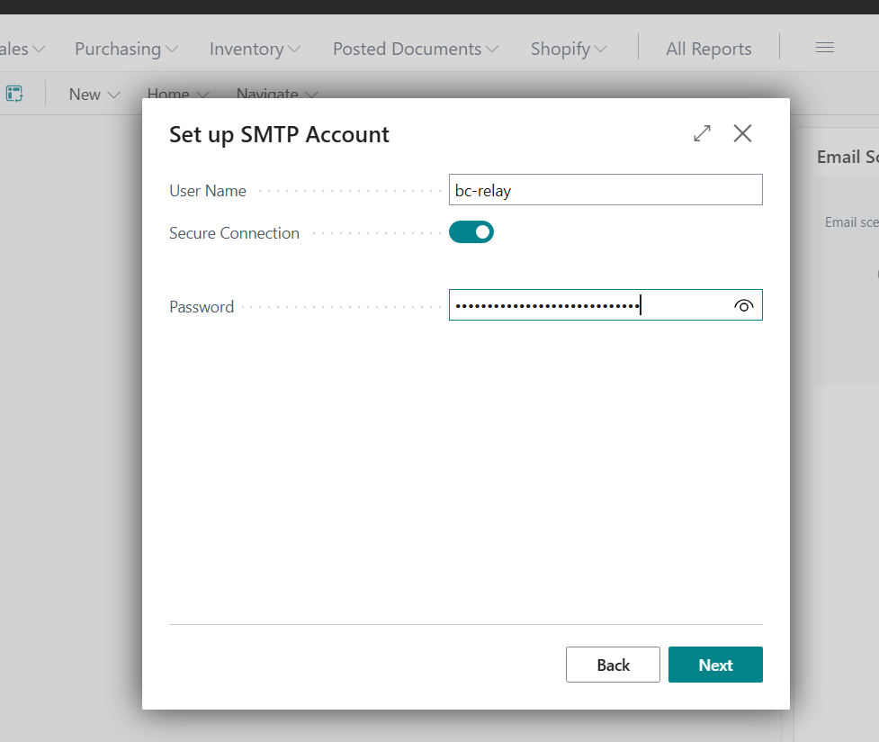
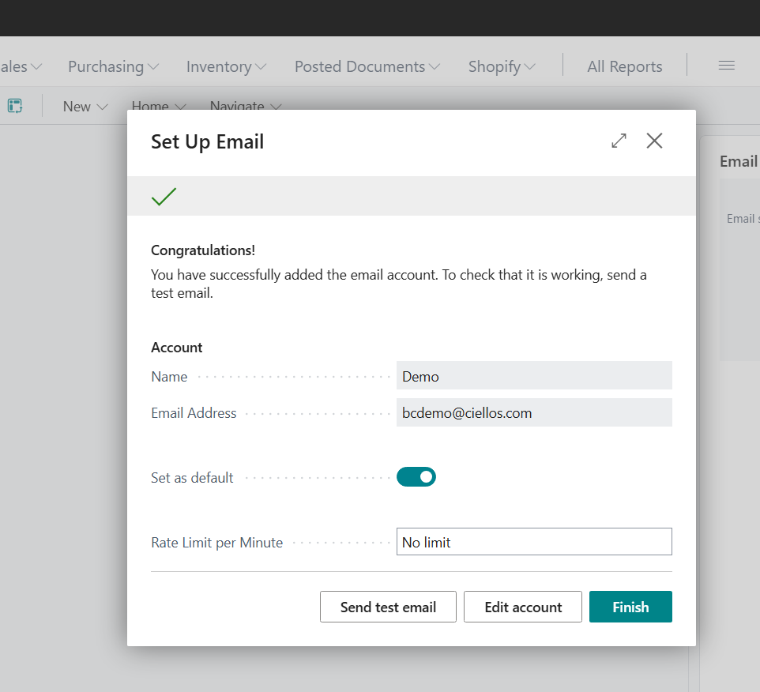
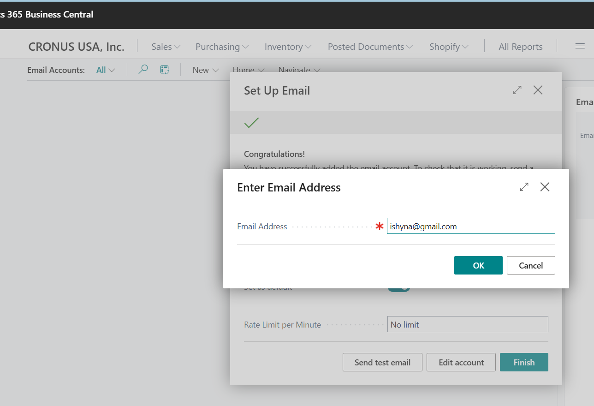
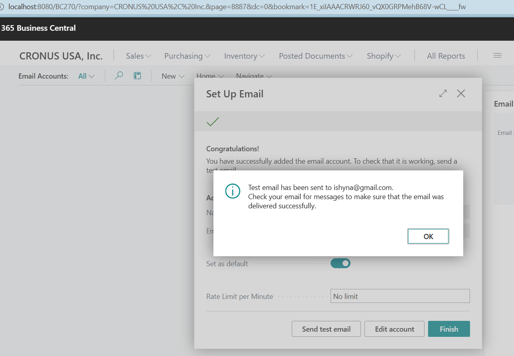
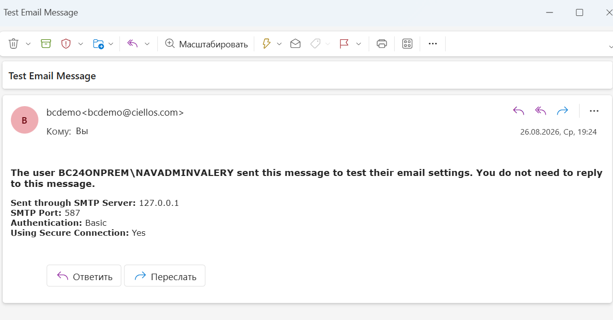

# SMTP2Graph Installation and Configuration Guide

This guide describes how to install SMTP2Graph on the same Windows Server as Microsoft Dynamics 365 Business Central on-premises and configure Business Central to relay email through Microsoft Graph.

> [!IMPORTANT]
> This configuration is intended for a local relay. SMTP2Graph listens only on `127.0.0.1`, so Business Central and SMTP2Graph must run on the same Windows Server.

> [!CAUTION]
> Never commit a real tenant ID, application ID, client secret, SMTP password, customer mailbox, or production IP address to Git. Use placeholders in documentation and store production secrets securely.

## Architecture

```text
Business Central on-premises
        |
        | SMTP AUTH to 127.0.0.1:587
        v
SMTP2Graph Windows service
        |
        | Application authentication
        v
Microsoft Graph -> Exchange Online mailbox
```

## Prerequisites

- Windows Server hosting Business Central on-premises.
- Local administrator access to the server.
- Access to Microsoft Entra ID with permission to configure an app registration.
- Exchange Online mailbox addresses that will be used as senders.
- SMTP2Graph installation package for the required cloud.
- Outbound HTTPS connectivity from the server to the Microsoft identity and Graph endpoints.

For the validated GCC High implementation, use the Ciellos GCC High build/release rather than an older commercial-only binary:

- GCC High release: `https://github.com/ciellosinc/SMTP2Graph/releases/tag/v1.1.5-gcchigh`
- GCC High development branch: `https://github.com/ciellosinc/SMTP2Graph/tree/preview/gcc-high-stack`

## 1. Create or review the Entra application

1. Open **Microsoft Entra admin center**.
2. Go to **App registrations**.
3. Create a new registration or open the registration dedicated to SMTP2Graph.
4. Record these values from **Overview**:
   - **Directory (tenant) ID**
   - **Application (client) ID**
5. Open **API permissions**.
6. Add **Microsoft Graph** -> **Application permissions** -> `Mail.Send`.
7. Grant tenant-wide admin consent.
8. Open **Certificates & secrets** and create a client secret.
9. Copy the secret **Value** immediately. Do not use the Secret ID.

If an Exchange application access policy restricts the application, ensure that every mailbox used as a sender is included in the permitted scope. Otherwise SMTP2Graph can return an `Access to mailbox ... denied` error.

## 2. Install SMTP2Graph

1. Sign in to the Windows Server that hosts Business Central.
2. Download the appropriate SMTP2Graph installation package.
3. If an older standalone instance is running, stop it before installing the Windows service.
4. Run `SMTP2Graph-setup.msi` as administrator.
5. Complete the installer.
6. Open `services.msc` and confirm that the **SMTP2Graph** service exists.
7. Locate the SMTP2Graph installation directory under **Program Files**.

## 3. Create `config.yaml`

1. In the SMTP2Graph installation directory, create or copy the configuration file.
2. Name the file exactly `config.yaml`.
3. Use the following sanitized template.

```yaml
# yaml-language-server: $schema=https://raw.githubusercontent.com/SMTP2Graph/SMTP2Graph/main/config.schema.json

mode: full

send:
  # GCC High endpoints
  loginUrl: https://login.microsoftonline.us
  graphUrl: https://graph.microsoft.us

  appReg:
    tenant: PASTE_TENANT_ID
    id: PASTE_APPLICATION_CLIENT_ID
    secret: PASTE_CLIENT_SECRET_VALUE

  retryLimit: 3
  retryInterval: 5

  # Keep this unset when Business Central users must send from their own mailboxes.
  # forceMailbox: shared-mailbox@customer-domain.example

receive:
  port: 587
  listenAddress: 127.0.0.1
  secure: false
  maxSize: 25m
  banner: Business Central SMTP Relay

  ipWhitelist:
    - 127.0.0.1
    - ::1

  # Keep the global allowedFrom list commented when authorized BC users
  # must send from different mailbox addresses.
  # allowedFrom:
  #   - approved-sender@customer-domain.example

  # Localhost-only traffic is protected by server/network access controls.
  allowInsecureAuth: true
  requireAuth: true

  users:
    - username: bc-relay
      password: PASTE_A_NEW_RANDOM_SMTP_PASSWORD
      # Optional per-user sender restriction:
      # allowedFrom:
      #   - approved-sender@customer-domain.example

  rateLimit:
    duration: 60
    limit: 10

  authLimit:
    duration: 30
    limit: 5
```

### Commercial cloud endpoint variant

For a standard commercial Microsoft 365 tenant, use:

```yaml
send:
  loginUrl: https://login.microsoftonline.com
  graphUrl: https://graph.microsoft.com
```

Do not mix commercial and GCC High identity or Graph endpoints.

## 4. Start or restart the service

1. Save `config.yaml`.
2. Open **Services**.
3. Restart the **SMTP2Graph** service.
4. Confirm that the service remains in the **Running** state.
5. If it stops, review SMTP2Graph log files in the application/log directory before continuing.

## 5. Configure the SMTP account in Business Central

1. In Business Central, search for **Email Accounts**.
2. Select **New** and choose the SMTP account option.
3. Enter the account settings:

| Setting | Value |
|---|---|
| Account Name | A descriptive name, for example `SMTP2Graph` |
| Sender Type | `Specific User` or the option required by the business scenario |
| Sender Name | Display name shown to recipients |
| Email Address | A real mailbox address permitted for the Entra application |
| Server Address | `127.0.0.1` |
| Server Port | `587` |
| Authentication | `Basic` |



4. Select **Next**.
5. Enter the local SMTP credentials defined in `config.yaml`:
   - **User Name**: `bc-relay`
   - **Secure Connection**: enabled in the validated Business Central setup
   - **Password**: the value configured under `receive.users.password`

> [!NOTE]
> The Business Central **Secure Connection** switch was enabled in the validated setup, while SMTP2Graph had `secure: false`, which allows the client to upgrade the connection. Keep SMTP2Graph bound to localhost.



6. Select **Next**.
7. Optionally select **Set as default**.
8. Select **Send test email** before finishing.



## 6. Test email delivery

1. Enter a recipient email address.
2. Select **OK**.



3. Confirm that Business Central reports that the test email was sent.



4. Verify that the message arrives in the recipient mailbox.
5. Confirm the expected sender, SMTP server, port, authentication, and secure-connection details.



## 7. Configure per-user sending

Use this section when each Business Central user must send from their own mailbox rather than from one shared mailbox.

1. Leave `send.forceMailbox` unset or commented.
2. Leave `receive.allowedFrom` and the SMTP user's `allowedFrom` unset, or explicitly include every approved sender.
3. Ensure each sender address is a real Exchange Online mailbox.
4. Ensure the Entra application is permitted to send from each mailbox.
5. In Business Central, use the sender configuration required for the current user scenario.
6. Test with at least one additional Business Central user.

## 8. Production rollout

1. Back up the existing SMTP2Graph configuration.
2. Confirm that production Business Central is hosted on the same server or has an explicitly approved network design.
3. Apply the production SMTP account settings using `127.0.0.1`, port `587`, Basic authentication, and the matching local relay credentials.
4. Set the SMTP2Graph account as the default email account if required.
5. Send a test email from production.
6. Test a second authorized sender if per-user sending is required.
7. Complete any remaining Business Central job queue configuration used for automated emails.

## Troubleshooting

### `535` authentication error

- Confirm that the Business Central username matches `receive.users.username`.
- Confirm that the password matches `receive.users.password` exactly.
- Check capitalization and remove accidental spaces.
- Restart SMTP2Graph after changing `config.yaml`.

### `Access to mailbox "..." denied`

- Confirm `Mail.Send` is configured as a Microsoft Graph **Application** permission.
- Confirm admin consent was granted.
- Confirm the mailbox exists in Exchange Online.
- Confirm the application access policy, if used, permits the sender mailbox.
- Confirm `forceMailbox` is not forcing an unintended mailbox.
- Review the SMTP2Graph error log for the exact sender address.

### Email should be sent as the current Business Central user

- Comment out `forceMailbox`.
- Remove or expand `allowedFrom` restrictions.
- Verify that every sender mailbox exists and is authorized for the application.
- Validate the Business Central email/account configuration for the current user.

### Service installs but does not run

- Validate YAML indentation and syntax.
- Confirm the file is named `config.yaml` and stored in the expected service directory.
- Confirm tenant ID, client ID, and client secret values are present.
- Confirm the correct cloud endpoints are used.
- Check the SMTP2Graph logs and Windows Event Viewer.

### Message is accepted but not delivered

- Check the SMTP2Graph send queue and logs.
- Verify outbound access to the correct Microsoft identity and Graph endpoints.
- Confirm the client secret is valid and not expired.
- Confirm the target sender mailbox is permitted.

## Security checklist

- [ ] SMTP2Graph listens only on `127.0.0.1` unless another design is explicitly approved.
- [ ] `config.yaml` is excluded from Git.
- [ ] Client secrets and SMTP passwords are not included in documentation or screenshots.
- [ ] The client secret value, not Secret ID, is configured.
- [ ] Secret expiration is monitored and rotation is planned.
- [ ] Only required Graph application permissions are assigned.
- [ ] Sender restrictions match the approved business scenario.
- [ ] Production test email is verified.
- [ ] Automated Business Central job queues are tested separately.

## Recommended `.gitignore`

```gitignore
# SMTP2Graph secrets and environment-specific configuration
config.yaml
config.yml
config.*.yaml
config.*.yml
*.log
queue/
```

## Validation result

The validated setup successfully sent test messages from Business Central through the local SMTP2Graph relay. The same relay configuration was then applied to the production Business Central environment on the same server, and test delivery succeeded there as well. Automated job queue processing remains a separate Business Central configuration step.
